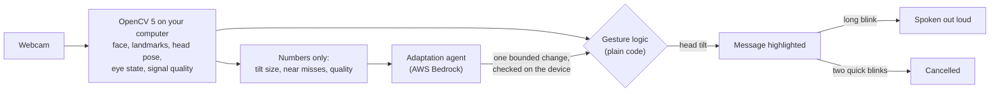
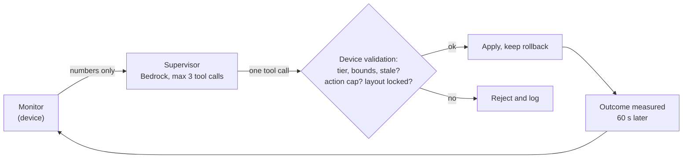

# HeadVoice

**Say what you need, with a tilt and a blink.**

HeadVoice is a webcam communication aid for people who cannot speak clearly or use their hands. The user tilts their head to highlight a message, holds a long blink to confirm it, and the computer says it out loud. A short calibration fits the interface to how the person can move, and an AI agent keeps adjusting it as they tire, using only measurements from OpenCV. Nothing is ever spoken without the user's own confirming blink.

Entry for the OpenCV AI Competition 2026. Research and education prototype, **not a medical device**.

| | |
| --- | --- |
| Website | https://d8wcckyu7sin3.cloudfront.net |
| Judge replay page (no webcam needed) | https://cj0mdhx3ul.execute-api.us-east-1.amazonaws.com/judge |
| Architecture and diagrams | [docs/architecture.md](docs/architecture.md) |
| Agent workflow and a real trace | [docs/agent_loop.md](docs/agent_loop.md) |
| Technical report | [docs/report.md](docs/report.md) |
| Safety rules | [RULES.md](RULES.md) |

---

## Contents

1. [How it works](#how-it-works)
2. [What is in the app](#what-is-in-the-app)
3. [Quick start](#quick-start)
4. [Using HeadVoice](#using-headvoice)
5. [How OpenCV 5 is used](#how-opencv-5-is-used)
6. [Adaptation agent and safety](#adaptation-agent-and-safety)
7. [AWS deployment](#aws-deployment)
8. [Evaluation and results](#evaluation-and-results)
9. [Configuration](#configuration)
10. [Development](#development)
11. [Repository layout](#repository-layout)
12. [Privacy](#privacy)
13. [Limitations](#limitations)
14. [Models and licenses](#models-and-licenses)

---

## How it works



1. **Look.** Sit in front of any webcam. HeadVoice learns your resting head position in about a second.
2. **Tilt to choose.** Tip your head toward a message (ear toward shoulder for left and right, chin up or down for up and down). The message highlights.
3. **Blink to say it.** Close both eyes until the ring around the message fills (about 0.7 s by default). The computer speaks it. Two quick blinks cancel a choice; a long blink with nothing highlighted shows other messages.

What makes it different:

- **Calibration chooses the interface.** A 25-second guided clip measures how far you can tilt in each direction against your own jitter, how you blink, and how open and closed your eyes look. It then picks a four-way layout or a left/right scanning layout and sets personal thresholds.
- **It adapts as you tire.** A session monitor turns OpenCV measurements into numbers (tilt size against your calibrated range, near misses, trend, quality). A supervisor agent on Amazon Bedrock reads them and makes one small, reversible change at a time, such as lowering tilt thresholds. Every change is validated on the device and its effect is measured a minute later.
- **Safety is code, not prompts.** The gesture state machine is a pure function that no AI output can reach. Eleven safety rules are enforced in code and covered by tests.
- **Video stays on the computer.** Only small numeric summaries can go to the cloud.

## What is in the app

| Part | What it is |
| --- | --- |
| Local app (`localhost:8765`) | Landing page, 4-step setup, the message screen, My messages, helper panel. Runs on the user's computer; the camera and OpenCV pipeline run here. |
| Website (CloudFront) | Public landing page, Windows download with a one-click launcher, privacy page. |
| AWS backend (CDK) | API with token auth, 9 Lambda functions from one OpenCV 5 container, Bedrock supervisor and message agents with a guardrail, encrypted S3, DynamoDB audit trail, CloudWatch dashboard. |
| Judge replay page | Public page that replays recorded and simulated sessions through each interface setup on AWS, with the agent's decisions and the numbers behind them. |

Screens of the local app:

- `/` landing page.
- `/start` setup in four steps: welcome and privacy, camera check (live preview, camera picker that flags frozen feeds, resting position), optional calibration, practice with two messages.
- `/app` the message screen: large message cards, a ring around the highlighted card that fills during the long blink, **a small live camera window in the top-right corner** (mirrored, border color shows signal quality), plain-language guidance, and a helper panel.
- `/messages` My messages: add the person's own phrases; they appear first.

## Quick start

### Option A: Windows, one click (for users)

1. Download the zip from the [website](https://d8wcckyu7sin3.cloudfront.net/download.html) and extract it.
2. Double-click **Start HeadVoice.bat**. The first start installs [uv](https://docs.astral.sh/uv/) and Python 3.11 if needed, installs the pinned dependencies, downloads the face models, then opens http://localhost:8765/ in your browser.
3. Follow the setup.

Downloaded copies run offline and adapt on the device with the rule policy; the cloud agent is used in research installs (option B).

### Option B: from source (for developers and judges)

Requirements: Python 3.11 (`.python-version`), [uv](https://docs.astral.sh/uv/), a webcam.

```sh
uv sync                                   # pinned versions from uv.lock
uv run python scripts/get_models.py       # YuNet face detector and LBF landmark model into models/
uv run python scripts/verify_opencv.py    # checks OpenCV 5.x and the models (add --camera 1 to test a webcam)
uv run uvicorn headvoice.app.server:app --port 8765
```

Open http://localhost:8765/. Without uv: `pip install -r requirements.lock && pip install -e .`

To run connected to a deployed AWS stack with the Bedrock agent (Windows PowerShell):

```powershell
.\scripts\run_app.ps1                      # agent policy, camera 1, condition normal
.\scripts\run_app.ps1 -Policy rule -Camera 0
```

The script reads `cdk-outputs.json` and the API token from Secrets Manager.

### Option C: no webcam

Open the [judge replay page](https://cj0mdhx3ul.execute-api.us-east-1.amazonaws.com/judge), pick a session and a setup, and press **Run replay** or **Compare all setups**.

## Using HeadVoice

### For the user

| Gesture | Effect |
| --- | --- |
| Tilt toward a message and hold briefly | Highlights it |
| Close both eyes until the ring fills | Speaks the highlighted message |
| Two quick blinks (or tilt down in left/right layouts, if calibration chose it) | Cancels the highlight |
| Long blink with nothing highlighted | Shows other messages |

The user never needs the keyboard.

### For a helper

| Key | Action |
| --- | --- |
| `S` | Start or stop a session (the key press also unlocks browser speech) |
| `N` | Re-center: take the current head position as resting |
| `C` | Calibrate (consent screen: `L` on this computer, `Y` secure cloud processing, `Esc` cancel) |
| `V` | Show or hide the camera window |
| `I` | Helper panel: layout picker, live measurements, adaptation decisions with their evidence, events, Research section |
| `T` / `K` | Start a scripted 10-message task / skip a target (for evaluation recordings) |

Choosing a layout in the helper panel locks it: the adaptation agent will not change it for that session.

Helpful tools:

```sh
uv run python scripts/list_cameras.py     # which camera indices give a live picture (phone-webcam drivers can repeat a frozen frame)
uv run python scripts/live_debug.py       # OpenCV window with landmarks, pose, eye openness, quality and FPS
```

## How OpenCV 5 is used

`opencv-contrib-python==5.0.0.93` on the device and `opencv-contrib-python-headless==5.0.0.93` in AWS Lambda run the same code.

| Stage | OpenCV API | Notes |
| --- | --- | --- |
| Face detection | `cv2.FaceDetectorYN` (YuNet `2026may` ONNX) | The OpenCV 5 ONNX Runtime engine needs the dynamic-shape export |
| Landmarks | `cv2.face.createFacemarkLBF` (68 points) | When YuNet misses a tilted face, LBF is refitted on a box carried from the previous landmarks (up to 15 frames) |
| Head pose | `cv2.solvePnP` for pitch and roll; yaw from 2D landmark geometry | 6-point PnP yaw flipped between two solutions on real data; geometric yaw is single-valued and unaffected by roll |
| Smoothing | One Euro filter | Stability is judged on the filtered pose |
| Eye state | `cv2.HOGDescriptor` + linear `cv2.ml.SVM` on aligned 48x24 eye crops | Landmark eye aspect ratio separated open from closed eyes at chance level; the SVM detected 24 of 24 held-out long blinks; 0.17 ms per frame |
| Low light | `cv2.createCLAHE` on the face region | Switched on with hysteresis when the face is dark or flat |
| Tracking fallback | `cv2.calcOpticalFlowPyrLK` | Bounded to 10 frames and never allowed to confirm a selection |
| Calibration and replay in the cloud | `cv2.VideoCapture` on the consented clip, same pipeline | Shared code, so cloud and device agree |

Measured on a laptop CPU at 640x480: about 30 fps (camera-limited); detection 10 to 11 ms, landmarks 4.5 ms, pose 0.6 ms, eye state 0.17 ms per frame. Details: [docs/models.md](docs/models.md).

## Adaptation agent and safety



- **Supervisor agent** (Claude Haiku 4.5 on Bedrock, Converse tool use, Bedrock guardrail). Tools: `get_window_summary`, `get_direction_reliability` (read-only), `adjust_sensitivity`, `adjust_timing`, `set_layout`, `request_hold_still`, `request_recalibration` (shows a prompt only), `no_change`. Evidence first: signal problems lead to "hold still", shrinking movement leads to lower thresholds first and a layout change only if a direction keeps failing.
- **Message agent** ranks phrasebook IDs with an abstain path; strict schema validation; it cannot speak.
- **Rule policy** is the deterministic baseline used offline and for comparison.
- **Guards:** no adaptation in a session's first minute (except for poor signal), a decision waits for the previous change's measured outcome, at most 3 adaptations per 2 minutes, bounds from `config/agent_bounds.json`, stale answers discarded by epoch, and a helper's layout choice is final.

The eleven rules in [RULES.md](RULES.md) are each covered by tests in `tests/test_safety.py`: code owns the state, fail closed, debounce, confirm before speaking, undo, stale-result guard, bounded agent, tool tiers (the agent can never speak, alert or see video), action cap, offline fallback, privacy.

Full workflow, guarantees and a real annotated trace: [docs/agent_loop.md](docs/agent_loop.md).

## AWS deployment

Everything is one CDK v2 stack (`infra/headvoice_stack.py`) in us-east-1. Diagrams: [docs/architecture.md](docs/architecture.md#aws-deployment).

Needs Docker (running), Node.js (for the CDK CLI via npx), AWS credentials, and Bedrock access to Claude Haiku 4.5 in us-east-1.

```sh
uv sync --all-groups
uv run python scripts/build_site.py                      # website files and the Windows zip into web/site/
npx aws-cdk@2 bootstrap aws://<ACCOUNT_ID>/us-east-1     # once per account and region
npx aws-cdk@2 deploy HeadVoice --outputs-file cdk-outputs.json
uv run python scripts/smoke_cloud.py                     # 9 end-to-end checks against the live API
```

On Windows pass the app explicitly, because `cdk.json` assumes an active virtual environment:

```powershell
npx aws-cdk@2 deploy HeadVoice --outputs-file cdk-outputs.json --app "<repo>\.venv\Scripts\python.exe infra\app.py"
```

Stack outputs: `ApiUrl`, `JudgeUrl`, `SiteUrl`, `TokenSecretArn`, `BucketName`, `GuardrailId`, `JudgeReplayFunction`.

After adding sessions to the judge page, precompute the agent replays (long agent replays exceed API Gateway's 30 s limit):

```sh
uv run python scripts/warm_replay_cache.py
```

Remove everything with `npx aws-cdk@2 destroy HeadVoice` (buckets, table, key and logs are configured to be deleted with the stack).

Measured on the live stack: Lambda cold start 430 to 620 ms (1.46 GB image); supervisor decisions 3.3 to 3.6 s median end to end in live sessions, about 4,800 input and 190 output tokens each, 0.006 USD per decision at the listed Haiku 4.5 price (0.17 USD for all 30 live decisions; confirm current prices on the AWS Bedrock pricing page).

## Evaluation and results

There were no volunteers. The evidence is:

1. **The developer's own live sessions** (one healthy adult, not a target user): 13 sessions, 22.5 minutes in total, with the agent on: 30 real agent decisions, 15 with measured outcomes, one rejected by the device as out of bounds. Anonymized (no landmarks) and published on the judge page as `developer_*`. They contain the real agent trace in [docs/agent_loop.md](docs/agent_loop.md).
2. **A simulated-users study**, clearly labeled as simulation: 30 simulated users (typical, limited up/down range, tremor-like noise) drive the real app closed loop, are calibrated by the real calibration code, and the agent arm calls the deployed supervisor. Parameters are anchored to the developer's measured tilt sizes, jitter and blink lengths.
3. **Component evaluations** on real data: eye-state model on labeled eye crops, message agent on 40 scripted scenarios, development replays of logged sessions.

Interface setups (arms): A fixed menu with generic profile, B dwell selection (no blink), C calibrated, D calibrated + rule policy, E calibrated + supervisor agent.

| Simulated users, task success | A | B | C | D | E |
| --- | --- | --- | --- | --- | --- |
| Normal | 0.65 | 0.65 | 0.93 | 0.92 | 0.93 |
| Fatigue (tilt size shrinks to 50% over 2 min) | 0.23 | 0.23 | 0.59 | 0.75 | 0.78 |

- Calibration matters most: users with limited up/down range went from 0.49 (fixed menu) to 1.0.
- Under fatigue, adaptation recovers much of the loss; the agent edges out the rule policy overall and loses to it for tremor-like users.
- Message agent (real Bedrock calls): the evidence-first prompt abstains on 93% of ambiguous scenarios against 43% for a careless prompt, at a small cost in top-1 accuracy (0.81 against 0.85); 0% invalid outputs.

Failure cases and limits are reported, not hidden: see the report's [failure cases](docs/report.md#8-failure-cases), including layout flip-flopping in the developer's session.

Reproduce:

```sh
uv run python eval/sim_users.py --agent api            # simulated users study -> eval/results/sim_summary.md
uv run python eval/run_message_eval.py --agent api     # message agent -> eval/results/messages_summary.md
uv run python eval/run_eval.py --agent api             # arms on recorded sessions in data/sessions
uv run python eval/sim_users.py --export-samples data/sample   # simulated sessions for the replay page
uv run python scripts/make_sample.py data/sessions/<session>.jsonl --name developer_session
aws s3 cp data/sample/ s3://<BucketName>/sample/ --recursive
```

Recording protocol: [eval/protocol.md](eval/protocol.md).

## Configuration

| Variable | Default | Meaning |
| --- | --- | --- |
| `HEADVOICE_CAMERA` | first camera with a live picture | Camera index |
| `HEADVOICE_PROFILE` | `config/default_profile.json` | User profile (calibration writes `data/profiles/`) |
| `HEADVOICE_POLICY` | `agent` if connected, else `rule` | Adaptation: `agent`, `rule` or `none` |
| `HEADVOICE_API_URL`, `HEADVOICE_API_TOKEN` | unset (offline) | Deployed API and bearer token |
| `HEADVOICE_CONDITION` | `normal` | Recording condition label (also settable in the helper panel) |
| `HEADVOICE_BEDROCK_MODEL_ID` | `us.anthropic.claude-haiku-4-5-20251001-v1:0` | Model for scripts that call Bedrock directly |

Files in `config/`: `default_profile.json` (thresholds, timings, layout), `phrasebook_en.json` (26 built-in messages), `agent_bounds.json` (what the agent may change and by how much).

## Development

```sh
uv sync --all-groups
uv run pytest                                   # 125 tests, including the 11 safety rules
uv run ruff check src tests scripts eval infra
uv run python scripts/verify_bedrock.py         # one Converse call with tool use
```

Logs: each session writes `data/sessions/session_<time>.jsonl` (per-frame measurements and events) and, with adaptation on, `traces_<time>.jsonl` (each decision with its evidence, validation and outcome). Replay any log through the real controller with `headvoice.replay.engine.replay_file`.

## Repository layout

```
src/headvoice/
  vision/        OpenCV 5 pipeline: detector, landmarks, pose, eye state, blink, quality, flow, camera
  interaction/   gesture state machine, tilt detection, layouts, menu pages
  calibration/   guided protocol, analysis (shared with the Lambda), clip recording
  agent/         monitor, rule policy, supervisor and message agents, tool tiers and bounds, adapter loop, traces
  replay/        replay engine, fatigue simulation, evaluation arms and metrics
  io/            schemas, logs, privacy check, cloud client, offline fallback, custom messages
  app/           FastAPI server, controller, web UI (static/)
  cloud/         Lambda handlers and the judge replay page
infra/           CDK stack
cloud/           Lambda container (Dockerfile, pinned requirements)
web/             website pages; web/site/ is the built output
config/          default profile, phrasebook, agent bounds
eval/            protocol, scenarios, evaluation runners, results
scripts/         setup, verification, debugging, site build, smoke tests, cache warm-up
tests/           unit, safety, replay, calibration, server and simulation tests
docs/            architecture, agent loop, report, models, video script, progress
```

## Privacy

- The camera picture is processed in memory on the user's computer and never stored or uploaded. The camera window and preview are served on localhost only.
- Local logs hold measurements (head angles, eye openness, quality, landmark positions) and chosen messages. They never upload automatically; shared samples have landmarks and face boxes removed.
- Cloud requests carry only numbers and short labels, checked by `io/privacy.check_outbound` on the device and again in the Lambda.
- Optional cloud calibration uploads a 25-second clip only after a consent screen. It is encrypted (KMS), read once and deleted immediately, with a 1-day lifecycle rule as a backstop.
- My messages are stored only in `data/custom_messages.json`.
- The eye-state model file keeps only the SVM weights; OpenCV's stored training vectors were removed.

## Limitations

- Research and education prototype, not a medical device; not tested with people who rely on such a device.
- No volunteers: real data comes from one person (the developer); arm comparisons rest on a simulated-users study, which is a model, not people.
- The eye-state model was trained on one person's eyes; per-user calibration re-thresholds it but does not retrain it.
- Sensitive to strong backlight and eye-only downward gaze (head-down pitch is handled).
- The adaptation agent can still flip layouts and act on quality-drop triggers; see the report's failure cases.
- The LBF landmark model has no license file in its source repository.

## Models and licenses

| File | Source | License |
| --- | --- | --- |
| `face_detection_yunet_2026may.onnx` | [opencv_zoo](https://github.com/opencv/opencv_zoo/tree/main/models/face_detection_yunet) | MIT |
| `lbfmodel.yaml` | [kurnianggoro/GSOC2017](https://github.com/kurnianggoro/GSOC2017) (OpenCV Facemark reference model) | No license file in the source repository |
| `eye_state_svm.yml`, `eye_state.json` | Trained in this project (`scripts/train_eye_model.py`) | Project's own |

Hashes and evaluation: [docs/models.md](docs/models.md).
