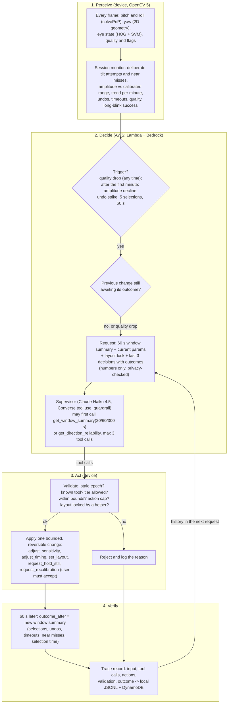

# Agent workflow: OpenCV measurements drive interface decisions

The supervisor agent adapts the interface to what OpenCV measures about the user right now. It never chooses or speaks messages, and it cannot touch the gesture state machine. Every decision is logged with the measurements that caused it, validated on the device, and its effect is measured one window later. The live developer session below shows OpenCV output changing a later agent action, with outcomes recorded.

## Loop

## Why this is not a fixed rule on one number

- The input combines several OpenCV signals: per-direction amplitude, near misses, the amplitude trend, undo and timeout counts, quality and its flags, long-blink success.
- The agent can ask for more evidence before acting (a longer window or per-direction reliability). In the developer's live sessions it did so before 28 of 30 decisions.
- Each request includes the last decisions and their measured outcomes, so a later decision depends on whether an earlier one helped. The live trace below shows this.
- `agent/rule_policy.py` is the single-signal rule baseline (setup D); the evaluation compares both.

## Decision rules given to the agent

- **Signal problem** (quality below 0.6, or unstable, low-light, turned-away or flow flags above 0.2): `request_hold_still` or `no_change`; do not change layout, timing or sensitivity.
- **Shrinking movement** (good quality, amplitude below about 0.75 of range, near misses, negative trend): lower thresholds first with `adjust_sensitivity` (one step, never below 0.5); switch to left/right scanning only if up and down still fail after that, or sensitivity is already at 0.5.
- **Slow but accurate:** lengthen the highlight timeout. **Unintended selections:** lengthen the tilt hold time.
- **Weak or conflicting evidence:** `no_change`. **Layout locked by a helper:** never `set_layout`.

## Guarantees enforced in code

| Guard | Where | Test |
| --- | --- | --- |
| Tool tiers: the agent can never speak, alert or see video | `agent/tools.py` | `tests/test_safety.py::test_8_*` |
| Bounds per parameter and layout (`config/agent_bounds.json`) | `agent/tools.py` | `test_7_*` |
| At most 3 tool calls per invocation | `agent/supervisor.py` (Lambda) and `AgentApplier` (device) | `tests/test_agents.py`, `test_7_max_tool_calls_per_invocation` |
| Stale answers discarded (session id and rising epoch) | `StaleGuard` | `test_6_*` |
| At most 3 adaptations per 2 minutes | `ActionCap` | `test_9_*` |
| Agent cannot change gesture state | the state machine is a pure function the agent layer never imports | `test_1_*` |
| No adaptation in a session's first minute, except for a quality drop | `agent/monitor.py` | `tests/test_server.py::test_no_adaptation_in_first_minute_and_glances_are_not_attempts` |
| Only deliberate tilts count (half the threshold, held 0.2 s) | `agent/monitor.py` | same test |
| Next decision waits for the previous change's outcome | `agent/adapter.py` | `tests/test_server.py::test_agent_waits_for_outcome_before_deciding_again` |
| A helper's layout choice is final | `AgentApplier.locked` | `tests/test_server.py::test_helper_layout_choice_locks_out_the_agent` |

## Real trace (the developer's own session)

Session `developer_1027_044434_8min` on the [judge replay page](https://cj0mdhx3ul.execute-api.us-east-1.amazonaws.com/judge): 7.9 minutes, one healthy adult (the developer, not a target user), webcam in an ordinary room, current adaptation rules, agent on. OpenCV measured the person live; the supervisor ran on Bedrock through the deployed API; every decision was validated on the device and logged locally and in DynamoDB. Times are from the start of the session.

| Time | Trigger | What OpenCV measured (60 s window) | Agent checked | Decision | Validation | Measured 60 s later |
| --- | --- | --- | --- | --- | --- | --- |
| 60 s | amplitude decline | tilt size vs range: left 0.54, right 0.46, up 0.88; 21 of 34 tilt attempts fell short; trend -0.31 per minute; quality 0.81 | per-direction reliability | `adjust_sensitivity` 1.0 to 0.8 | applied | 16 of 32 attempts short; down at 0.33 of range |
| 120 s | amplitude decline | down at 0.33 of range, 0 of 6 down attempts succeeded; sensitivity already lowered to 0.8; quality 0.92 | per-direction reliability | `set_layout` four-way to left/right scanning | applied | 11 of 29 attempts short |
| 170 s | quality drop | quality 0.70, unstable 0.29, low light 0.08 | 60 s summary, per-direction reliability | `request_hold_still` | applied | |

Why this is the evidence the competition asks for:

- **OpenCV output decided the action.** The decision at 60 s rests on the measured tilt amplitudes, attempt counts and trend.
- **A later decision depended on an earlier one.** At 120 s the agent's reason states that sensitivity "was already lowered" and down still failed, so it changed the layout: the escalation its rules prescribe.
- **The agent told signal problems from user problems.** When quality dropped at 170 s it asked the person to hold still instead of changing settings.
- **The first decision came at exactly 60 s**, the end of the warm-up, so nothing changed on thin evidence.

### What went wrong in the same session

Reported as found, from the same trace:

- **Layout flip-flopping.** Left/right scanning at 120 s, back to four-way at 241 s, scanning again at 364 s, four-way again at 457 s.
- **Setting changes on quality-drop triggers.** At 160, 302, 364 and 457 s the trigger was a quality drop, yet the agent changed sensitivity or layout instead of only asking the person to hold still. Its rules say a signal problem should lead only to `request_hold_still` or `no_change`. A device-side check that enforces this is not yet built.

### Bounds enforced on live data

In the developer's 1.5-minute session `developer_1027_045315_2min`, 41 s in and on a quality-drop trigger, the agent requested `adjust_sensitivity` 0.4, below the allowed minimum of 0.5. The device rejected it (`value_out_of_bounds`) and logged it. Nothing changed. The other five decisions in that session were all `request_hold_still`.

### All live sessions

13 developer sessions, 22.5 minutes in total, published anonymized on the judge page. The first 9 ran an earlier version of the adaptation rules (first decision 10 to 30 s into a session, mostly layout switches); that behaviour is why the warm-up, deliberate-attempt and sensitivity-first rules exist.

| | Decisions | With evidence checked first | Outcome measured | Rejected by the device | Actions | Median latency | Bedrock cost |
| --- | --- | --- | --- | --- | --- | --- | --- |
| Earlier rules (9 sessions) | 11 | 11 | 4 | 0 | 7 layout, 2 sensitivity, 1 hold still, 1 timing | 3.6 s | 0.06 USD |
| Current rules (3 sessions) | 19 | 17 | 11 | 1 (out of bounds) | 10 hold still, 5 sensitivity, 4 layout | 3.3 s | 0.11 USD |

## Example trace (simulation, not a person)

From the simulated-users study (`eval/results/sim_traces.jsonl`, user sim00, fatigue condition, setup E). The decision is a real call to the deployed supervisor; the measurements come from a simulated user, not from OpenCV watching a person.

| Step | What happened |
| --- | --- |
| Trigger | 5 selections since the last summary |
| Measured (60 s window) | tilt amplitude vs calibrated: left 0.93, up 0.77, down 0.90; trend -0.257 per minute; quality 0.88; no undos or timeouts |
| Checked first | `get_direction_reliability` |
| Decision | `adjust_sensitivity` 1.0 to 0.85, reason cites the falling trend and good quality |
| Validation | in bounds, reversible tier, current epoch: applied |
| Outcome 60 s later | 7 tilt attempts, 0 short, 4 selections |

Annotation: the stated reason contains an error ("up at 0.77 (below 0.75 threshold)"; 0.77 is above 0.75). The action is still supported by the falling trend, and it was small, bounded and reversible. This is why each decision is validated on the device and its outcome measured, rather than trusting the model's explanation.
