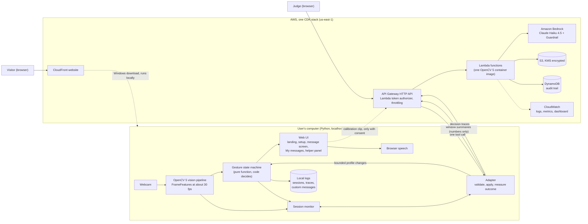
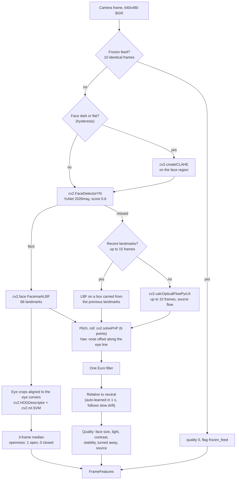
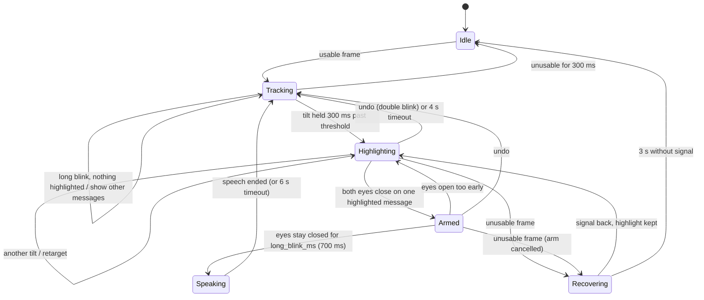
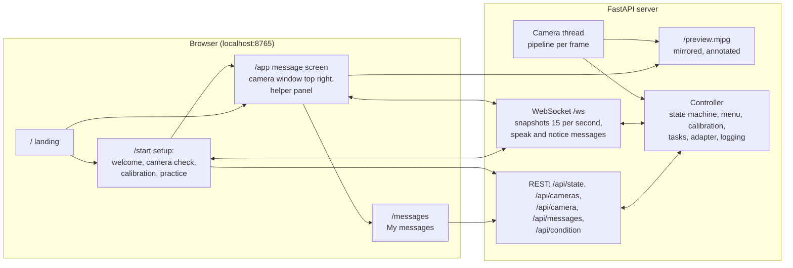
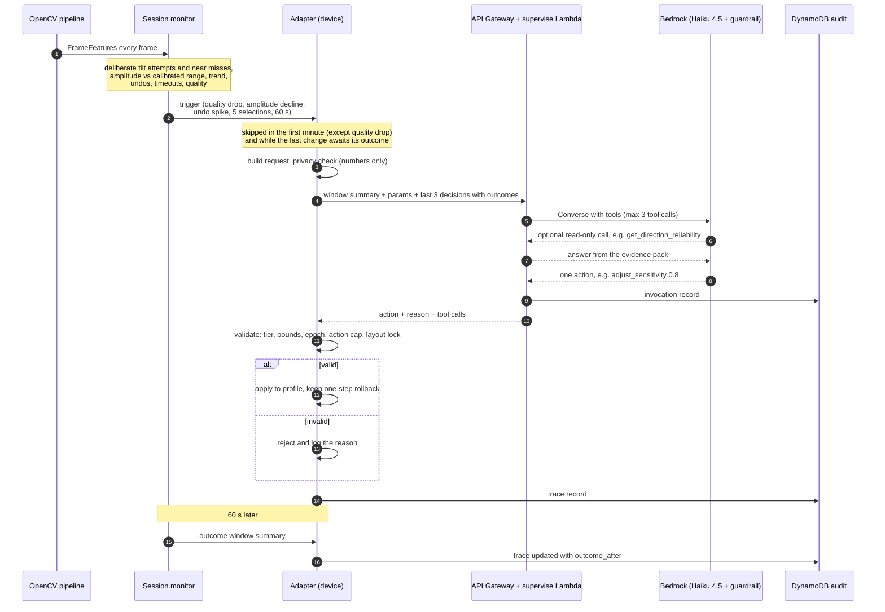
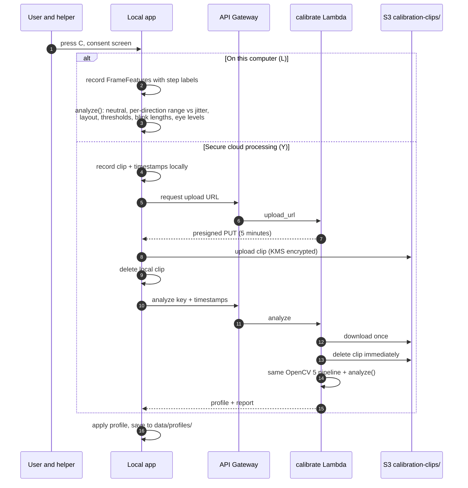
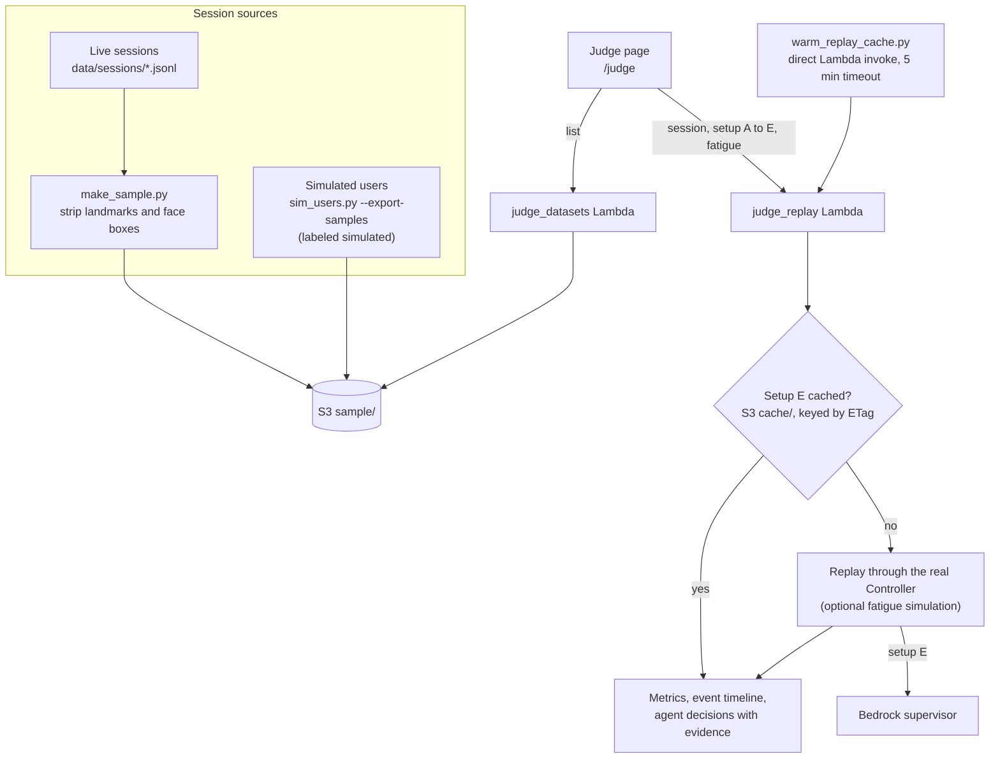
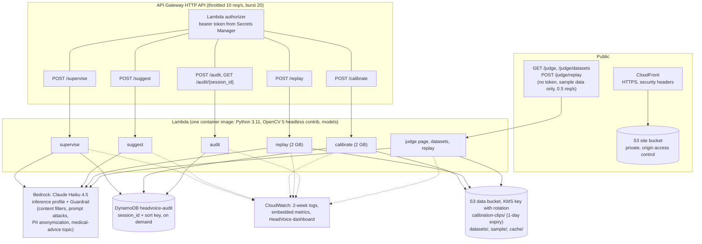
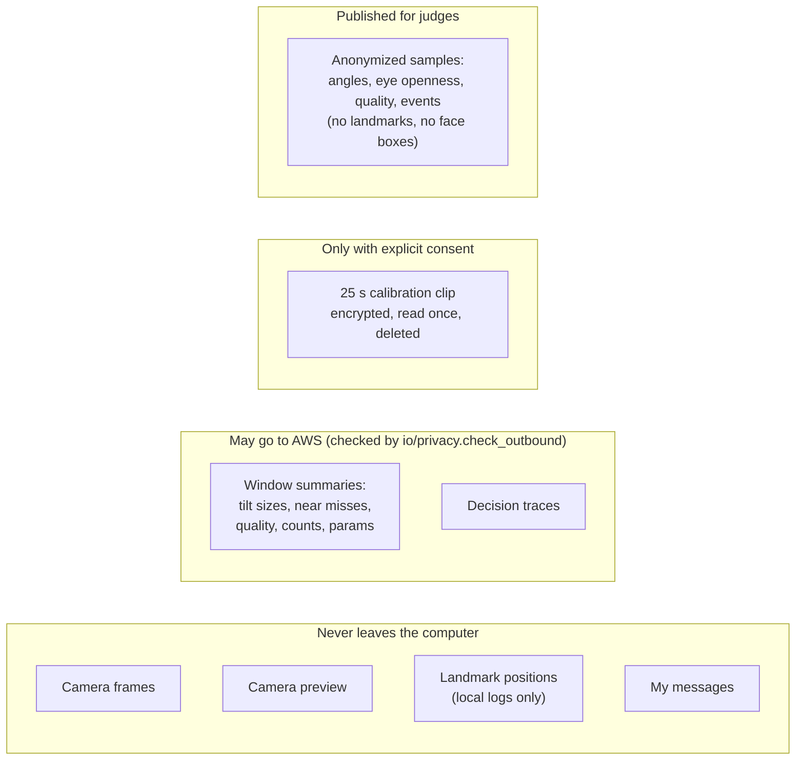

# HeadVoice architecture

HeadVoice is split by one rule: **the camera picture and every decision about what to say stay on the user's computer.** The device runs the webcam, the OpenCV 5 pipeline, the gesture state machine, the user interface and speech. AWS runs what benefits from the cloud: the adaptation and message agents on Amazon Bedrock, calibration and replay jobs (the same OpenCV 5 code in a container), the audit trail, the public website and the judge replay page. Only numeric summaries cross that boundary, plus a calibration clip the user explicitly agrees to upload, which is deleted as soon as it is read.

Contents:

1. [System overview](#1-system-overview)
2. [Per-frame vision pipeline](#2-per-frame-vision-pipeline)
3. [Gesture state machine](#3-gesture-state-machine)
4. [Local app](#4-local-app)
5. [Adaptation loop](#5-adaptation-loop)
6. [Calibration](#6-calibration)
7. [Replay, evaluation and the judge page](#7-replay-evaluation-and-the-judge-page)
8. [AWS deployment](#aws-deployment)
9. [Data, privacy and security](#9-data-privacy-and-security)
10. [Code map](#10-code-map)

---

## 1. System overview

| Part | Runs on | Why there |
| --- | --- | --- |
| Camera, OpenCV pipeline | Device | Real time, and the picture never leaves the computer |
| Gesture state machine, speech | Device | Safety: no network or model can make the app speak |
| Web UI, camera window, custom messages | Device (FastAPI, localhost only) | The preview and personal phrases stay local |
| Offline phrase list and rule policy | Device | Works with no connection |
| Session monitor and adapter | Device | Every agent decision is validated where it is applied |
| Supervisor and message agents | Lambda + Bedrock | Model access, guardrail, central audit |
| Calibration analysis | Device, and Lambda for consented clips | Same code in both places |
| Replay and evaluation | Lambda and locally | Judges can test without a webcam |
| Audit trail | DynamoDB | Every invocation and device trace, per session |
| Website | CloudFront + private S3 | Public information and the download |

---

## 2. Per-frame vision pipeline

Every camera frame becomes one `FrameFeatures` record (`src/headvoice/vision/pipeline.py`): time, face found, landmarks, landmark source, yaw, pitch, roll relative to the user's neutral, left and right eye openness, quality score and quality flags.

Measured on a laptop CPU: detection 10 to 11 ms, landmarks 4.5 ms, pose 0.6 ms, eye state 0.17 ms; the 30 fps camera is the limit. Why each choice was made (YuNet export, LBF over unavailable alternatives, geometric yaw, the eye-state model) is documented with measurements in [models.md](models.md) and the [report](report.md#4-opencv-5-implementation).

---

## 3. Gesture state machine

`step(state, features, profile, now) -> (state, events)` in `src/headvoice/interaction/state_machine.py`. It is a pure function: no network, no model, and the agent layer never imports it. Default timings from `config/default_profile.json`.

A frame is usable only if a face is found, landmarks come from the model (never optical flow), the head is not turned away, quality is at least 0.5 and pose is known. Every unusable frame cancels an armed blink, and after a dropout or speech the eyes must be seen open before a new blink counts. One function, `_confirm`, is the only place a speak event exists.

---

## 4. Local app

The browser speaks only when the server sends a `speak` message, which the controller sends only for a speak event from the state machine. The same `Controller` class drives the replay engine, so replayed sessions produce the same events as live ones.

---

## 5. Adaptation loop

The adapter (`src/headvoice/agent/adapter.py`) runs perceive, decide, act, verify. With policy `agent` the decision is made by the supervisor on Bedrock; with policy `rule` by the deterministic baseline on the device.

Tool tiers, bounds and their tests: [agent_loop.md](agent_loop.md). A real trace from a live session is in the same document.

---

## 6. Calibration

The guided clip (`src/headvoice/calibration/protocol.py`, about 25 s) asks for neutral, each tilt direction, natural blinks and three long blinks. The analysis (`analyze.py`) is the same on the device and in the calibrate Lambda.

Layout rule: four reliable directions give `four_way`; reliable left and right only give `binary_scan` (left/right scanning); otherwise the current layout is kept and the result is flagged. A direction is reliable if its range clears both 8 degrees and six times the user's jitter, and was reached consistently. A 1-day lifecycle rule on `calibration-clips/` is a backstop if the Lambda ever fails before deleting.

---

## 7. Replay, evaluation and the judge page

- Setups: A fixed menu with generic profile, B dwell selection, C calibrated, D calibrated + rule policy, E calibrated + supervisor agent (`src/headvoice/replay/arms.py`).
- Agent replays of long sessions take longer than API Gateway's 30 s limit, so they are precomputed and cached in S3.
- The simulated-users study (`eval/sim_users.py`) runs closed loop against the real Controller: each simulated user reads the screen, plans tilts and blinks, and is calibrated by the real analysis. Replay of logged sessions is open loop and cannot show how a person would react to a changed layout.

---

## AWS deployment

One CDK v2 stack, `infra/headvoice_stack.py` (87 resources).

| Concern | How it is handled |
| --- | --- |
| Authentication | Bearer token checked by a Lambda authorizer (constant-time compare), stored in Secrets Manager, results cached 5 minutes |
| Least privilege | Only the agent and replay functions may call Bedrock; only calibrate may touch `calibration-clips/`; replay and judge functions read `sample/` and read/write `cache/` |
| Encryption | Data bucket: customer-managed KMS key with rotation, TLS enforced, public access blocked; DynamoDB encrypted; site bucket private behind CloudFront |
| Throttling | Stage default 10 requests per second (burst 20); public judge replay 0.5 per second (burst 2) |
| Observability | Embedded metric format: agent latency, tool calls, no-change rate, estimated cost, device-side rejections, stale discards, calibration time; Lambda errors; one dashboard |
| One image for all functions | Cloud and device run identical code; numpy is pinned to 2.2.6 on both because newer wheels need a newer glibc than the Amazon Linux 2 base |
| Teardown | `cdk destroy` removes buckets (auto-delete), table, key and log groups |

Measured: cold start 430 to 620 ms; supervisor decision about 3 to 4 s end to end; replay of a 7-minute session through setups A to D under 3 s.

---

## 9. Data, privacy and security

- The outbound check rejects binary data, arrays, landmark or frame fields, long lists and long strings; the supervise Lambda runs it again.
- The agent cannot speak, send alerts or access video: those tools are refused in code on the device.
- The eye-state model file stores only the linear SVM weight vector; OpenCV's copy of the training vectors (features of the developer's eye crops) was removed.

---

## 10. Code map

| Path | Responsibility |
| --- | --- |
| `src/headvoice/vision/` | Camera opening and liveness, face detection, landmarks, pose, eye state, blink helpers, quality and CLAHE, optical-flow fallback, the pipeline |
| `src/headvoice/interaction/` | Gesture state machine, tilt tracking and debounce, layouts, menu paging |
| `src/headvoice/calibration/` | Guided protocol, analysis, recording and clip processing |
| `src/headvoice/agent/` | Session monitor, rule policy, supervisor and message agents, tool tiers and bounds, adapter loop, trace records |
| `src/headvoice/replay/` | Replay engine (drives the real Controller), fatigue simulation, arms, metrics |
| `src/headvoice/io/` | Schemas, JSONL logs, privacy check, cloud client, offline fallback, custom messages |
| `src/headvoice/app/` | FastAPI server, Controller, web UI |
| `src/headvoice/cloud/` | Lambda handlers, judge page |
| `infra/` | CDK app and stack |
| `cloud/` | Lambda Dockerfile and pinned requirements |
| `web/` | Website pages and the built site |
| `eval/` | Protocol, scenarios, evaluation runners, simulated users, results |

See also: [agent_loop.md](agent_loop.md) (agent workflow and traces), [report.md](report.md) (technical report), [models.md](models.md) (models and their evaluation), [../RULES.md](../RULES.md) (safety rules).
